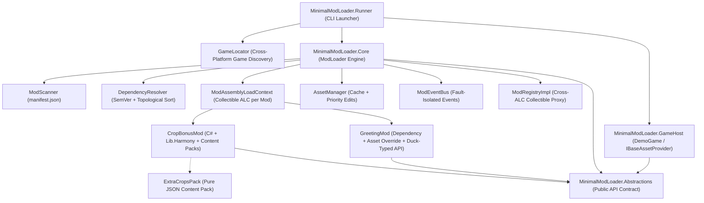

# MinimalModLoader

> **Mod Loader ต้นแบบสร้างจากศูนย์ด้วย C# (.NET 8)** ออกแบบสถาปัตยกรรมแบบ Modular คล้าย SMAPI แยกชั้นชัดเจนระหว่าง **Mod API Contract**, **Loader Engine**, **Cross-Platform Game Locator**, **Demo Game Host**, และ **Sample Mods**


---

## ภาพรวมสถาปัตยกรรม (Architecture)



---

## ความสามารถหลัก (Key Features)

1. **Manifest Discovery (`ModScanner`)**
   - สแกนหา `manifest.json` แบบ recursive ในโฟลเดอร์ `Mods/`
   - ข้ามโฟลเดอร์ที่ขึ้นต้นด้วย `.` อัตโนมัติ (เช่น `.disabled`)
   - แยก **C# Code Mod** (`EntryDll`) และ **Content Pack** (`ContentPackFor`) อัตโนมัติ

2. **Dependency Resolution & SemVer (`DependencyResolver`)**
   - ตรวจสอบ `MinimumLoaderVersion`, `UniqueID` ซ้ำ และ `MinimumVersion` แบบ SemVer (`Major.Minor.Patch[-Prerelease]`)
   - จัดลำดับการโหลดด้วย **Kahn's Topological Sort**
   - ตรวจจับ **Circular Dependency** และข้ามม็อดที่ขาด Dependency หลักแบบ cascade โดยไม่กระทบม็อดอื่น พร้อมรองรับ Optional Dependency แบบพึ่งพากันโดยไม่ติด false cycle

3. **Isolated Plugin Loading (`ModAssemblyLoadContext`)**
   - โหลดแต่ละม็อดแยกใน Collectible `AssemblyLoadContext` (`isCollectible: true`)
   - โหลดไฟล์ `.dll` ผ่าน `MemoryStream` เพื่อไม่ล็อกไฟล์บน Windows
   - แชร์ Assembly แกนหลัก (`MinimalModLoader.Abstractions`, `MinimalModLoader.GameHost`, `0Harmony`) จาก Default ALC เพื่อให้ชนิดข้อมูลและ Harmony ทำงานร่วมกันได้

4. **Asset Pipeline (`AssetManager`)**
   - แคช Asset พร้อมรองรับการแทนที่ไฟล์ (`LoadFrom` / `LoadFromModFile`)
   - รองรับการแก้ไขต่อยอดหลายชั้นตามลำดับความสำคัญ (`Early` → `Default` → `Late`)
   - รองรับ `InvalidateCache()` เพื่อโหลด Asset ใหม่เมื่อค่าคอนฟิกเปลี่ยน

5. **Fault-Isolated Event Bus (`ModEventBus`)**
   - แยก `try/catch` ต่อม็อด เมื่อม็อดหนึ่งโยน Exception จะไม่ทำให้เกมหรือม็อดอื่นล่มตาม
   - ยกเลิกการ subscribe Event ทั้งหมดของม็อดอัตโนมัติเมื่อ `Dispose()`

6. **Runtime Patching (`Lib.Harmony`) & Clean Teardown**
   - รองรับการแพตช์เมธอดเกมตอนรันไทม์ (`Prefix` / `Postfix`)
   - ถอด Harmony patch (`UnpatchAll`) และ `Unload()` ทุก `AssemblyLoadContext` ในลำดับย้อนกลับเมื่อปิด Loader กลับสู่พฤติกรรม Vanilla อย่างสะอาด

7. **Cross-ALC Inter-Mod API (Collectible Dynamic Proxy)**
   - ม็อดหนึ่งเรียก API ของอีกม็อดผ่าน Interface ภายในตัวเองได้ทันทีแบบ Duck-Typed โดย **ไม่ต้องอ้างอิง DLL ของกันและกันตอนคอมไพล์**
   - ใช้ `Reflection.Emit` แบบ `AssemblyBuilderAccess.RunAndCollect` ทำให้ใช้งานข้าม Collectible ALC ได้โดยไม่เกิด memory leak (แก้ข้อจำกัดของ `DispatchProxy` มาตรฐานใน .NET)

8. **Cross-Platform `GameLocator` (ไม่ฝังไฟล์เกมในแอป)**
   - ค้นหาตัวเกมภายนอกอัตโนมัติตามลำดับความสำคัญ:
     1. CLI Argument (`--game-path`)
     2. Environment Variable (`MINIMAL_MOD_LOADER_GAME_PATH` / `STARDEW_GAME_PATH`)
     3. ไฟล์ตั้งค่าที่บันทึกไว้ (`game-locator.json`)
     4. Custom Platform Provider (`IGameLocationProvider` สำหรับต่อกับ Android `PackageManager` / SAF ในอนาคต)
     5. พาธติดตั้งมาตรฐาน (Steam + `libraryfolders.vdf`, GOG, Xbox)
     6. สแกนโฟลเดอร์และไดรฟ์แบบจำกัดความลึก (`MaxScanDepth`, `MaxVisitedDirectories`)
   - ตรวจยืนยันทั้งโฟลเดอร์เกม PC (`Stardew Valley.dll` + `Content/`) และไฟล์ Android (`.apk`, `.apks`, `.xapk`) ด้วยตัวอ่าน **Binary XML `AndroidManifest.xml`** (`AndroidBinaryXmlInspector` รองรับทั้ง UTF-8 และ UTF-16 string pool โดยไม่ต้องแตกไฟล์ลงดิสก์)

---

## โครงสร้างโปรเจกต์ (Project Structure)

```text
MinimalModLoader/
├── Directory.Build.props                    # ตั้งค่า .NET 8 / C# 12 / Nullable ร่วมทั้ง Solution
├── MinimalModLoader.sln                     # Solution file รวมทุกโปรเจกต์
├── src/
│   ├── MinimalModLoader.Abstractions/       # สัญญา Public API (IMod, ModBase, IModHelper, SemVer, IGameLocator ฯลฯ)
│   ├── MinimalModLoader.Core/               # ตัวเครื่อง Loader หลัก + โมดูล GameLocator
│   │   └── GameLocator/                     # GameLocator, GamePathInspector, AndroidBinaryXmlInspector, Providers
│   ├── MinimalModLoader.GameHost/           # เกมจำลอง (DemoGame, PricingEngine, CropDefinition)
│   └── MinimalModLoader.Runner/             # CLI Launcher + auto-stage Sample Mods ลงโฟลเดอร์ Mods/
├── samples/
│   ├── CropBonusMod/                        # Sample C# Mod: config.json + Lib.Harmony + Content Pack + Inter-Mod API
│   ├── GreetingMod/                         # Sample C# Mod: Dependency + Asset Override + Cross-ALC Duck-Typed API
│   └── ExtraCropsPack/                      # Sample Content Pack: JSON ล้วน (AncientFruit, SweetGemBerry)
└── tests/
    └── MinimalModLoader.Tests/              # ชุดทดสอบ xUnit (ModLoaderTests + GameLocatorTests)
```

---

## ความต้องการของระบบ (Prerequisites)

- [.NET 8 SDK](https://dotnet.microsoft.com/download/dotnet/8.0) (`net8.0` / C# 12)

---

## วิธี Build, ทดสอบ และรันใช้งาน

```bash
# 1. Build ทั้ง Solution (จะ stage ม็อดตัวอย่างลงโฟลเดอร์ Mods/ อัตโนมัติ)
dotnet build MinimalModLoader.sln

# 2. รันชุดทดสอบ xUnit ทั้งหมด (10 Tests)
dotnet test MinimalModLoader.sln

# 3. ค้นหาตัวเกมทั้งหมดในเครื่อง (ไม่รันเกมเดโม)
dotnet run --project src/MinimalModLoader.Runner -- --locate-only

# 4. รันเดโม Mod Loader เต็มรูปแบบ (Vanilla -> Modded -> Post-Unload)
dotnet run --project src/MinimalModLoader.Runner
```

> **หมายเหตุ (Windows):** หากในเครื่องติดตั้ง .NET 8 SDK ไว้เฉพาะ User Profile (เช่น `%LOCALAPPDATA%\Microsoft\dotnet\dotnet.exe`) ให้เรียกผ่านพาธนั้นแทน `dotnet`

### ตัวเลือก CLI ของ `MinimalModLoader.Runner`

| Flag | คำอธิบาย |
| :--- | :--- |
| `--game-path <path>` | ระบุโฟลเดอร์เกมหรือไฟล์ `.apk` / `.apks` / `.xapk` โดยตรง |
| `--save-game-path <path>` | ตรวจยืนยันและบันทึกพาธเกมลงไฟล์ `game-locator.json` |
| `--search-root <dir>` | เพิ่มโฟลเดอร์สำหรับสแกนหาตัวเกม (ใส่ได้หลายครั้ง) |
| `--config <file>` | กำหนดพาธไฟล์ `game-locator.json` เอง |
| `--locate-only` | แสดงผลตัวเกมทั้งหมดที่ตรวจพบแล้วจบการทำงาน |
| `--no-drive-scan` | ข้ามการสแกนไดรฟ์หลักทั้งหมด |
| `--mods-dir <dir>` | กำหนดโฟลเดอร์ `Mods/` เอง |
| `-h`, `--help` | แสดงรายการคำสั่งทั้งหมด |

---

## ตัวอย่างผลลัพธ์จากการรัน Demo

- **Vanilla (ก่อนโหลดม็อด):**
  - `Strings/Greeting`: `"Welcome to Minimal Valley! (Base Game Asset)"`
  - ขาย Parsnip 10 ชิ้น = **`350g`**
- **Modded (หลังโหลด `CropBonusMod` → `GreetingMod` + `ExtraCropsPack`):**
  - `GreetingMod` เชื่อมต่อ API ของ `CropBonusMod` ข้าม Collectible ALC สำเร็จ (`Multiplier=1.5x, ContentPackCrops=2`)
  - `Strings/Greeting` ถูกแทนที่ด้วยไฟล์ `GreetingMod/assets/greeting.txt`
  - `Data/Crops` เพิ่มจาก 3 พืชเป็น **6 พืช** (`Starfruit` จาก C# Mod + `AncientFruit` และ `SweetGemBerry` จาก JSON Content Pack)
  - Harmony Postfix คูณราคาขาย 1.5x: ขาย Parsnip 10 ชิ้น = **`525g`**, ขาย AncientFruit 2 ชิ้น = **`1650g`**
- **Post-Unload (หลัง `ModLoader.Dispose()`):**
  - ขาย Parsnip 10 ชิ้น กลับมาเป็น **`350g`** (Harmony ถูกถอดออกสะอาด)

---

## การเขียนม็อดตัวอย่าง (Writing a Mod)

### 1. C# Mod (`manifest.json` + `ModBase`)

```json
{
  "UniqueID": "Author.MyMod",
  "Name": "My Mod",
  "Author": "YourName",
  "Version": "1.0.0",
  "MinimumLoaderVersion": "1.0.0",
  "EntryDll": "MyMod.dll",
  "Dependencies": []
}
```

```csharp
using MinimalModLoader.Abstractions;

public sealed class MyMod : ModBase
{
    public override void Entry(IModHelper helper)
    {
        helper.Events.GameLaunched += (_, _) =>
            Monitor.Log("MyMod initialized!");
    }
}
```

### 2. Pure JSON Content Pack (`manifest.json` + `content.json`)

```json
{
  "UniqueID": "Author.ExtraCropsPack",
  "Name": "Extra Crops Pack",
  "Author": "YourName",
  "Version": "1.0.0",
  "ContentPackFor": {
    "UniqueID": "Minimal.CropBonusMod",
    "MinimumVersion": "1.0.0"
  }
}
```

---

## ชุดทดสอบ (Test Coverage — 10/10 Passing)

- **ModLoader Core (`ModLoaderTests.cs` — 6 tests):**
  - `SemVer` parsing & comparison (รวม prerelease)
  - Topological sort, missing dependency cascade, และ circular dependency detection
  - Mutual optional dependencies (ไม่เกิด false cycle)
  - Asset Pipeline (replacement, priority ordering `Early` → `Late`, cache & invalidation)
  - Event Bus fault isolation (ม็อดหนึ่งโยน exception ไม่กระทบม็อดอื่น)
  - End-to-End: โหลด Sample Mods + Content Pack + Harmony Patch + Cross-ALC Duck-Typed API + Clean Unload
- **GameLocator (`GameLocatorTests.cs` — 4 tests):**
  - Binary `AndroidManifest.xml` parser (UTF-16 / UTF-8) และคัดกรองแพ็กเกจอื่นทิ้ง
  - Bundle inspector สำหรับ `.xapk` (`manifest.json`) และ `.apks` (nested `base.apk`)
  - ลำดับความสำคัญของการค้นหา (CLI > Env > Config > FileSystem Scan)
  - Pluggable `IGameLocationProvider` สำหรับต่อยอดบน Android (`content://` SAF / `PackageManager`)

---

## บันทึกการพัฒนา (Changelog)

### v1.0.0
- วางโครงสร้าง Solution และแยกชั้น Public API (`MinimalModLoader.Abstractions`) กับ Core Engine (`MinimalModLoader.Core`)
- พัฒนาระบบหลัก 7 ส่วน: `ModScanner`, `DependencyResolver`, `ModAssemblyLoadContext`, `AssetManager`, `ModEventBus`, `ModRegistryImpl` (Collectible Dynamic Proxy), และ `ModLoader`
- เพิ่ม `MinimalModLoader.GameHost` (`DemoGame`, `PricingEngine`) และ `MinimalModLoader.Runner`
- สร้างม็อดตัวอย่าง 3 ตัว (`CropBonusMod`, `GreetingMod`, `ExtraCropsPack`)
- เพิ่มโมดูล `GameLocator` ค้นหาตัวเกมภายนอกอัตโนมัติ (PC + Android `.apk`/`.apks`/`.xapk` พร้อม Binary XML Inspector) โดยไม่ฝังไฟล์เกมไว้ในโปรเจกต์
- เพิ่มชุดทดสอบ xUnit ครบ 10 กรณีทดสอบ (ผ่าน 100%, 0 warnings)

---

## แนวทางต่อยอดสู่เกมจริง / .NET for Android

- **เปลี่ยน Game Host:** แทนที่ `DemoGame` (`IBaseAssetProvider`) ด้วยตัวอ่าน Asset จากเกมจริง (เช่น MonoGame `ContentManager`)
- **ขยาย Game Events:** เพิ่ม Event จาก Game Loop จริง (Input, Rendering, SaveLoaded ฯลฯ) ลงใน `IModEvents`
- **รันบน Android (`.NET for Android`):** ใช้ `MinimalModLoader.Abstractions` และ `MinimalModLoader.Core` ต่อได้ทันที พร้อมลงทะเบียน `IGameLocationProvider` สำหรับ Android `PackageManager` / SAF และตั้งค่า `<RunAOTCompilation>false</RunAOTCompilation>` เพื่อให้ Mono Interpreter/JIT รองรับ `AssemblyLoadContext` และ `Lib.Harmony`
